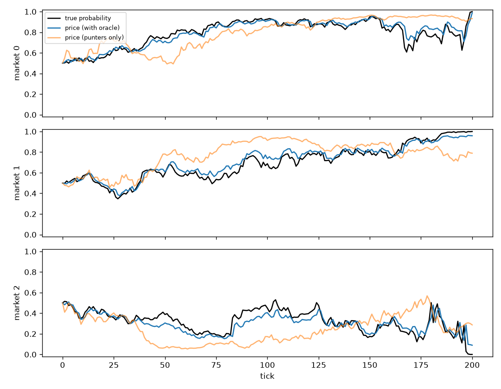
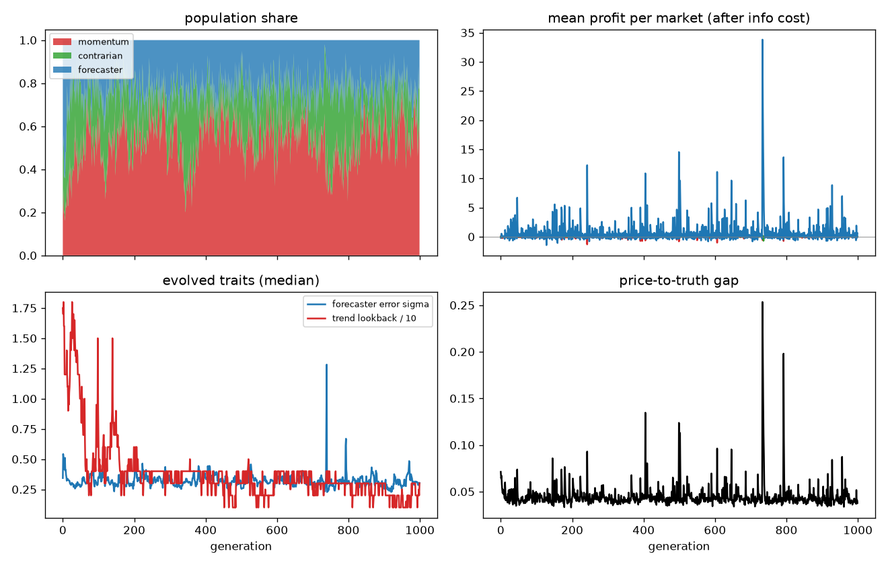
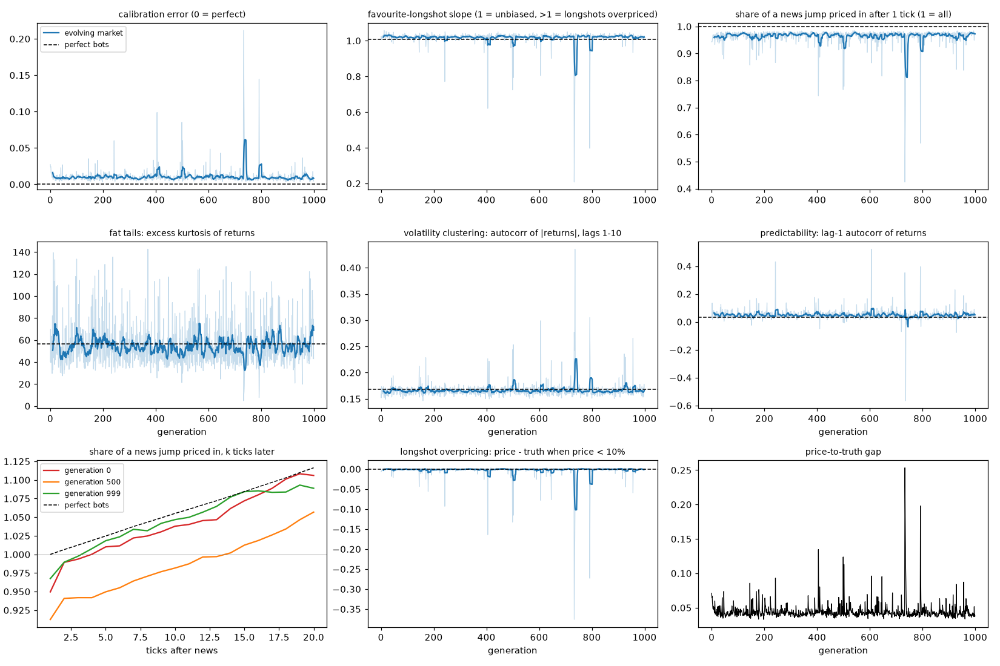
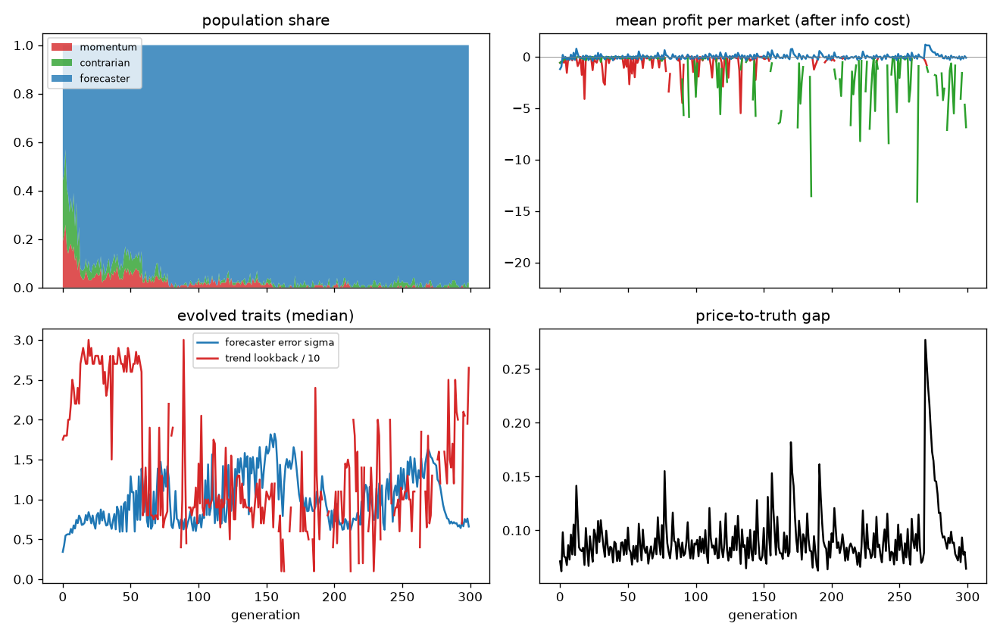
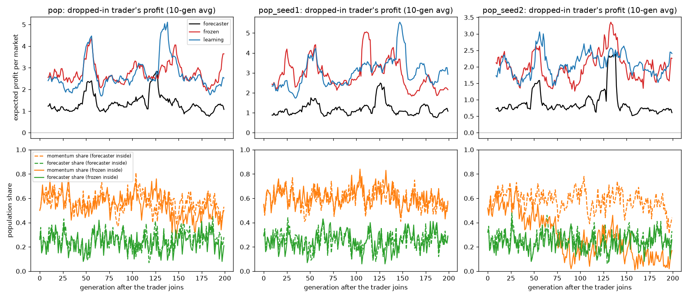
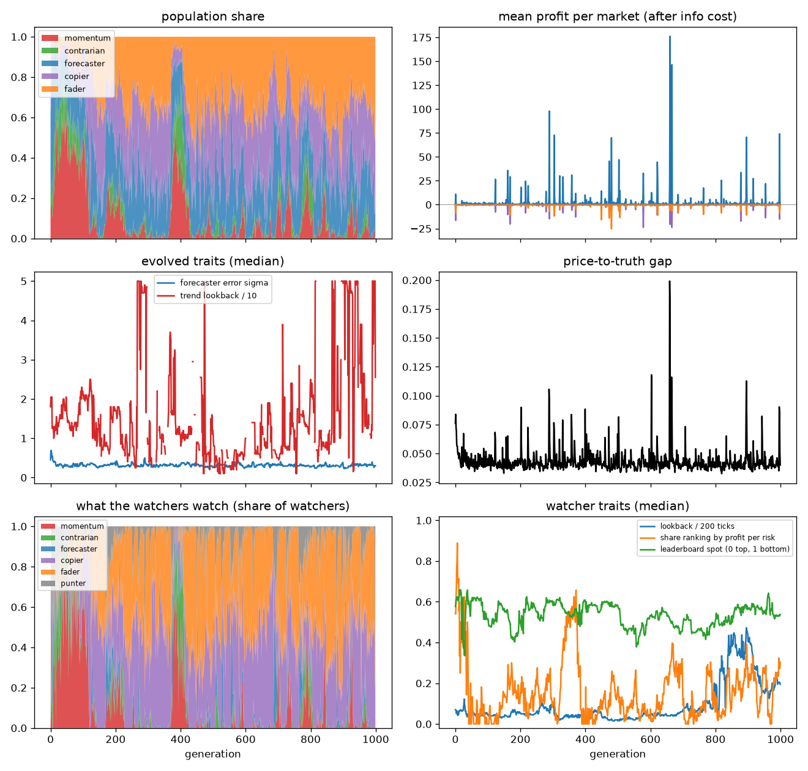
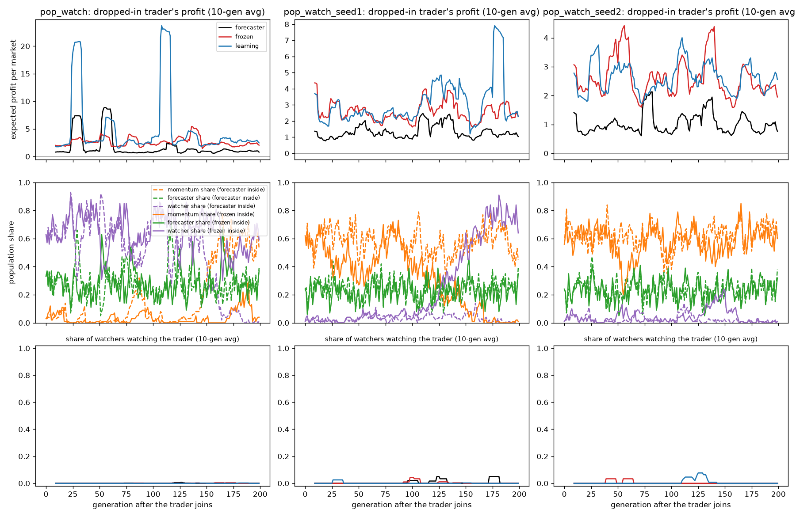

# Prediction Arena

A population of trading bots competing on simulated prediction markets. Bots trade, go bust and
reproduce; Bayesian and reinforcement-learning agents are dropped in to see whether they can keep
an edge against a population that evolves around them.

## Key results

- **Evolution finds a stable but cyclical market.** A small core of forecasters (~23%) keeps prices
  within ~0.045 of the true probability, in boom-and-bust cycles: the scarcer they are, the more
  each one earns.
- **Fees cost accuracy.** A 0.2c fee per share makes prices ~70% less accurate; 1c doubles the error.
- **A Bayesian trader trades profit for safety.** A Kalman filter that learns its own error halves
  profit but cuts risk 2.5-3x; it mistakes the price distortion caused by noise traders for its own error.
- **Public wallets let copiers free-ride.** Copying the best wallet (ranked by profit per unit of
  risk) earns about as much as a forecaster, with no information of its own.
- **An RL agent (PPO) earns ~4x a forecaster**, still more than a forecaster with no size cap. It also
  found a loophole in the market design within 2 training iterations, which is now fixed.
- **Its edge shows no clear decay** over 200 generations of co-evolution, including when the
  population can evolve wallet watchers that copy or fade wallets by leaderboard spot: they almost
  never land on the agent.
- **Watchers become copy-trading herds.** They take over the trend bots' do-little niche at times,
  and when they dominate they can pile into the same positions; big mispricings are more common then.

## Repository layout

| | |
|---|---|
| `arena/market.py` | the market: truth process, LMSR market maker, uniform-price batch auction (Phase 1) |
| `arena/evolve.py` | the evolving bot population (Phase 2); `--watchers` adds an evolving wallet-watcher species (Phase 4) |
| `arena/measure.py` | market-quality measures and dashboard (Phase 3) |
| `arena/kalman.py` | Bayesian (Kalman-filter) trader (Phase 4) |
| `arena/wallets.py` | public wallet ledger and copy-trading watchers (Phase 4) |
| `arena/ppo.py` | reinforcement-learning trader (Phase 4) |
| `arena/decay.py` | edge decay: trained agent inside the evolving population (Phase 4) |
| `figures/` | charts made by the experiments, including every chart in this README |
| `runs/` | run outputs (histories, populations, trained agents); not in git, regenerated by the commands below |

Every module checks itself when run (`python -m arena.<module>`) before running its experiment.

## The market (`arena/market.py`)

- **Truth.** Each market is a binary event. A hidden "score lead" does a random walk with rare news
  jumps, and the event happens if the lead is positive at the end. The true probability is the
  chance the lead holds given the time left: `p = Phi(lead / sqrt(var * ticks_left))`, so it drifts
  toward 0 or 1 as the market nears resolution.
- **Market maker.** An LMSR (logarithmic market scoring rule) market maker takes the net order of
  all bots each tick. Its worst-case loss per market is capped at `b * ln 2`.
- **Uniform-price batch auction with limit orders.** Each tick, all orders clear at one price and
  everyone trades at that price. Price-sensitive bots say how many shares they'd hold at any price,
  and the clearing price is solved exactly. Without batching, bots reacting to the old price all
  piled in together and the price swung between ~0 and ~1 every tick.
- **Full collateral, as on real prediction markets.** A long position must be paid for in cash and a
  short must keep $1 per share in cash, fees included, so no bot can ever lose more than its budget.
  An early version without this let bots run up debt (one lost 240 on a budget of 100). A built-in
  check has reckless bots trade at random at fees of 0, 1c and 5c and confirms nobody loses more
  than they had.
- **Speed.** All vectorised in numpy. The clearing price takes ~5-7 evaluations of everyone's orders
  per tick (a guarded Newton/secant search that gives the same answer as 30 rounds of bisection),
  so one generation (400 markets x 200 ticks, 150 bots) takes ~1.5-4 s on a laptop.

**A loophole found by the RL agent.** Earlier versions filled everyone at the market maker's
*average* price over the batch, while bots chose their orders at the *clearing* price. Whoever
traded with the net flow got a better price than they'd planned for, so a big trader could push the
clearing price past the truth and buy cheaply from the bots selling into it. The PPO agent (Phase 4)
found this within 2 training iterations and earned 17x a forecaster while prices barely moved. The
market now uses a single uniform price, as frequent batch auctions do, and every result below was
re-run on the fixed market. The fix changed the evolved ecology (Phase 2).

## Phase 1: does the market work?

50 random "punters" plus one test oracle that sees the true probability, over 100 markets. The
oracle is a deliberately unrealistic test instrument: if even a bot that knows the truth couldn't
pull the price to it, the market would be broken. It isn't used after Phase 1.

| | per market |
|---|---|
| Oracle profit | +14.0 |
| Punter profit | -0.4 each |
| Market maker P&L | +5.0 (worst -28.4, cap -34.7) |
| Price-to-truth gap | 0.116 with oracle vs 0.317 punters only |
| Calibration of the true probability | worst bin off by 1.7% (20k markets) |



## Phase 2: an evolving population (`arena/evolve.py`)

- **Who trades:** 100 evolving strategy bots, plus 50 punters who don't evolve (they lose money, so
  evolution would wipe them out, and with them every other bot's profit).
- **Strategies (the genome):** trend followers hold `alpha x (log-odds move over the last L ticks)`
  (alpha > 0 momentum, < 0 contrarian); forecasters each have their own noisy estimate of the truth
  (error size sigma) and hold `alpha x (estimate - price)`. Half of every forecaster's error is shared
  with all the others in that market (same data, same models), so the crowd can't simply average its
  mistakes away. Accuracy costs `0.05 / sigma^2` per market, so forecasters choose how much to buy.
- **Each generation:** 400 fresh markets; fitness is total profit; the bottom 20 die and are replaced
  by mutated copies of tournament winners (best of 3); 5% of children switch strategy type; bot size
  is capped at 100. Results are from 3 seeds x 1000 generations.

Things that had to be fixed before the results meant anything (each mirrors a real market effect):

1. **Selection was half luck.** Over 100 markets, a bot's rank on one set of markets agreed with its
   rank on another at only 0.50; at 400 markets it's 0.91.
2. **Insiders starved everyone.** Two bots seeing 10 ticks ahead took most of the profit and killed
   the forecasters (adverse selection). They're out for now and return as a stress-test scenario.
3. **Too little "food".** The only free money is what punters lose; with small punters, the best
   strategy was to barely trade.
4. **Unbounded size made fake bubbles.** Bot size drifted from 13 to ~1000. Size is now capped.
5. **Independent errors made the market unrealistically perfect.** 50 forecasters with independent
   errors average them out almost completely; real traders' errors are correlated.
6. **Bots could lose money they didn't have** (no collateral; see above).
7. **Average-price fills were a free option** for whoever traded with the crowd (see above).

### Result: boom and bust around a small core of forecasters

All three seeds end up in the same kind of ecology (averages over generations 500-999):



- **Forecasters are ~23-24% of the population**, at size ~90 (near the cap) and accuracy
  sigma = 0.30-0.31. They're the only bots that make money: +0.89, +1.03 and +0.02 per market after
  paying for accuracy (seed 2 has rare crash generations, the worst at -12.4 per market).
- **The other ~76% are trend followers that have evolved to almost stop trading** (size 0.1-1.5) and
  earn about 0. (Their "momentum" or "contrarian" label in the charts is just the sign of a
  near-zero size.) They survive because selection removes the 20 worst bots each generation: a bot
  earning exactly zero is never among them, while forecasters' profits are noisy enough that the
  unlucky ones often are. Truncation selection punishes risk.
- **Boom and bust.** The fewer forecasters there are, the more each one earns (correlation -0.35 to
  -0.57 between their share and their profit). When they get scarce the price drifts from the truth
  (the gap spikes to 0.19-0.42 in the worst generations), the survivors make big profits (up to +34
  per market in one generation), and they multiply again.
- Punters lose ~0.4 per market.

Before the loophole was fixed, one seed grew a momentum herd that caused bubbles. That was the
loophole at work: trading with the crowd was subsidised. With a uniform price, market orders pay
their full price impact, trend-following doesn't pay, and no seed forms a herd.

## Phase 3: measuring the market (`arena/measure.py`)

Because the simulator knows the true probability, every measure compares the price with the truth
directly, and with a "perfect bots" benchmark on the same markets. Each measure is checked in
`python -m arena.measure` on fake markets with a known answer (perfect, timid, slow).



Averages over generations 500-999:

| | perfect bots | seed 0 | seed 1 | seed 2 |
|---|---|---|---|---|
| price-to-truth gap | 0.020 | 0.045 | 0.046 | 0.044 |
| calibration error | 0.000 | 0.011 | 0.011 | 0.010 |
| share of news priced in after 1 tick | 1.00 | 0.96 | 0.96 | 0.96 |
| favourite-longshot slope (1 = unbiased) | 1.01 | 1.02 | 1.02 | 1.02 |
| predictability (lag-1 autocorr of returns) | 0.04 | 0.05 | 0.03 | 0.05 |

The evolved market is about twice as far from the truth as perfect bots, but well calibrated and
unbiased.

**What didn't emerge:** fat tails and volatility clustering match the perfect-bot benchmark, so they
come from the news jumps built into the truth, not from the bots. There's no favourite-longshot bias
either: punters here trade at random, while real punters overbet longshots, and adding that
preference is the obvious next experiment.

### Fees: even 0.2c makes prices noticeably worse

Same setup with a fee per share traded, seeds 0 and 2, 300 generations each, averages over
generations 150-299 and over the two seeds (they tell the same story):

| | no fee | 0.2c fee | 1c fee |
|---|---|---|---|
| price-to-truth gap | 0.044 | 0.074 | 0.093 |
| calibration error | 0.009 | 0.032 | 0.040 |
| share of news priced in after 1 tick | 0.97 | 0.90 | 0.89 |
| forecasters (share, size, error sigma) | 23%, ~88, 0.32 | 20%, 61-83, 0.33 | 98%, 2-3, 1.0 |
| forecaster profit per market (after info cost) | +0.53 | +2.4 | ~0 |
| punter loss per market (mostly fees at 1c) | 0.40 | 2.6 | 8.8 |

- **0.2c:** fewer or smaller forecasters, each earning more (less competition), and prices 70% less
  accurate.
- **1c:** a forecaster's edge per share is smaller than the fee, so evolution shrinks forecasters to
  size 2-3 and lets them stop paying for accuracy. Nobody corrects mispricings, so the gap doubles,
  and the punters' losses go to the exchange, not to traders.



## Phase 4: learning agents

Every agent below is dropped into the final evolved population of each seed (generation 999) and
compared with an identical forecaster on the same 2000 markets.

**Measuring profit.** Each market resolves to 0 or 1, and a 90-share position turns that coin flip
into about +-12 of luck per market, which buried every difference. Because the simulator knows the
true probability at every tick, each trade is valued at the truth when it was made instead. That
gives the same average with ~10x smaller error bars (the bookkeeping is checked against real profit
in every run).

### A Bayesian trader (`arena/kalman.py`)

The Kalman trader gets exactly what a forecaster gets: its own estimate of the true probability
(with an error fixed for the market, half of it shared with everyone) and the market price. It also
learns its own error: every tick it compares its last estimate with the price that cleared on it,
and a Kalman filter turns those comparisons into a best guess of its error. One setting, tau, says
how noisy it thinks the price is: tau = inf is a plain forecaster, small tau trusts the price.


| per market (seeds 0, 1, 2) | forecaster | Kalman (tau 0.1-0.3) |
|---|---|---|
| expected profit | +0.51, +0.52, +0.49 | +0.24 to +0.26 (about half) |
| risk (s.d. of profit) | 11.7, 8.9, 7.9 | 4.0, 3.4, 3.0 |
| profit per unit of risk | 0.044, 0.058, 0.063 | 0.064, 0.075, 0.087 (1.3-1.5x) |

- **It does learn its error.** Its estimate ends up 25% closer to the truth (seed 0), and what it learns is
  the private half of its error (correlation 0.68, close to sqrt(0.5)); the shared half can't be
  learned from the price, because the price carries the same mistake.
- **But it learns some of the market's mistakes as its own.** Punters' accumulated positions push
  the price away from the truth, and a forecaster profits by leaning against that. The Kalman trader
  can't tell that distortion from its own error: the mistake in its learned error correlates -0.36
  with the punters' net position (its true error: -0.05). So it "corrects" itself into agreement
  with the distorted price, holds a third of the position, and earns half as much, mostly late in
  the market when the distortion has built up.

### Visible wallets (`arena/wallets.py`)

On Polymarket every position is public under a pseudonymous wallet. The simulator works the same
way: every bot can see every wallet's position after the last tick, and a public leaderboard of past
profit, but never a wallet's strategy. Does that ledger hold exploitable information? A wallet
watcher copies (or fades) the average position of the top (or bottom) wallets on a leaderboard
built from 2000 earlier markets:

| watcher (2000 test markets, seeds 0, 1, 2) | expected profit per market | risk |
|---|---|---|
| copy the top wallet by **profit** (always a lucky punter) | -0.46, -0.50, -0.53 | 24 |
| copy the top wallet by **profit per unit of risk** (a forecaster) | +0.81, +0.76, +0.39 | 5-11 |
| copy the top 10 by profit per unit of risk (all forecasters) | +0.63, +0.53, +0.58 | 5-7 |
| fade the bottom 10 by profit (mostly punters) | +0.28, +0.30, +0.38 | 7-8 |

- **Copying luck loses.** Punters hold big random positions, so over 2000 markets the luckiest one
  out-earns every forecaster, and copying it loses money. Ranking by profit per unit of risk finds
  the skilled wallets.
- **Copiers free-ride.** A watcher with no information of its own, a tick behind, earns as much as a
  forecaster (often more) without paying for accuracy: transparency lets copiers live off informed
  traders.
- **Fading the punters pays**: their accumulated positions keep the price slightly off.

### A reinforcement-learning trader (`arena/ppo.py`)

- **Same information** as the forecaster and Kalman trader: its private estimate, the price, its own
  position, and the public ledger (positions and last trades of the top and bottom 10 wallets).
- **Its actions** each tick: a shift to its valuation and a multiplier on its size (capped at 100,
  like every bot). With both at 0 it is exactly a forecaster, and training starts there.
- **Reward:** each trade valued at the true probability when it was made (the network never sees
  the truth). PPO as in CleanRL; each iteration is 400 markets against the evolved population;
  150 iterations (~10 min on a laptop CPU).
- **Checks:** with its last layer zeroed it reproduces the forecaster's profit exactly; the first PPO
  update checks that the recorded actions and log-probabilities line up.


| per market (seeds 0, 1, 2) | expected profit | risk | profit per unit of risk |
|---|---|---|---|
| forecaster (size ~90) | +0.51, +0.52, +0.49 | 7.9-11.7 | 0.044-0.063 |
| best plain forecaster with no size cap (size ~400) | +0.99, +1.33, +1.43 | 33-34 | ~0.03-0.04 |
| PPO | **+1.92, +1.90, +2.12** | 17.7-23.7 | **0.081-0.120** |

- **PPO earns ~4x the forecaster**, and still more than any plain forecaster with the size cap
  removed, at lower risk than that one. Trading bigger explains a third to 60% of its edge.
- **What it learned** (its actions regressed on its inputs): it raises its valuation when it already
  holds a position (which lets it trade bigger than the cap), subtracts its average past
  disagreement with the price (a Kalman-style correction), leans toward what the top wallets hold,
  and trades bigger late in the market.
- Training was still improving at 150 iterations.

### Edge decay: does the population adapt to the agent? (`arena/decay.py`)

The trained agent joins its evolving population (it never reproduces or dies) for 200 more
generations; the population evolves on profit as usual, so whatever the agent takes becomes
selection pressure. Three versions: a plain forecaster (control), the agent frozen, and the agent
still learning (one PPO update per generation).



| expected profit per market, first -> last 25 generations | forecaster | PPO frozen | PPO learning |
|---|---|---|---|
| seed 0 | +1.16 -> +1.03 | +2.70 -> +2.76 | +2.39 -> +2.17 |
| seed 1 | +0.99 -> +0.98 | +3.03 -> +2.22 | +2.37 -> +2.81 |
| seed 2 | +0.76 -> +0.65 | +2.09 -> +2.02 | +1.94 -> +2.03 |

- **The edge doesn't decay.** The frozen agent keeps earning 2-3x the forecaster for 200
  generations, so continued learning has nothing to fix.
- **The population barely notices it.** Forecaster share and market accuracy are the same with or
  without the agent. No evolving species can single out one wallet, so the agent's cut never becomes
  something selection can target; all three traders simply rise and fall with the forecasters'
  boom-and-bust cycle.
- So the next experiment gives the population a way to hunt the agent: an evolving wallet-watcher
  species that can copy or fade specific wallets.

### An evolving wallet-watcher species (`arena/evolve.py --watchers`)

A third species that evolves alongside trend bots and forecasters. Every wallet's position is
public, and so is a leaderboard of last generation's profits (ranked by raw profit, or by profit
per unit of risk). A watcher's genome picks:

- **a spot on the leaderboard** (0 = top, 1 = bottom) and which ranking to use;
- **alpha**: + copies the wallet in that spot, - fades it, and how big;
- **lag**: it holds alpha x (the wallet's position now - its position lag ticks ago). A short lag
  follows the wallet's latest trades; a whole-market lag copies its entire position.

It watches a spot, not a fixed wallet, since wallets change hands as bots die. A bot born this
generation isn't ranked (its column's record belongs to the bot it replaced), and no watcher
watches itself. Positions are seen after the previous tick's trades, as on chain.

**Checks:** a watcher holds exactly alpha x (the wallet's move), and the leaderboard picks the right
wallet. One-off tests also found that a watcher copying the top wallet earns what `wallets.py`'s
dropped-in copier does on the same markets (+0.33 per market), and that with watchers off, short
reference runs (15 generations of evolution, a Kalman drop-in, 3 generations of decay) give the same
numbers as before. The longer experiments weren't rerun. Two traps found by investigating odd
results, each now covered by a check:

- **Ties.** Watchers often end a generation on exactly 0, and numpy's sort favoured some columns
  among ties: in a test, all tie deaths fell in the first 40 of 100. Ties are now broken at random.
- **Switching species.** A forecaster's child that became a watcher kept its size (~100), copied at
  100x, lost ~40 per market and fed everyone else for a generation (a PPO agent trained on a
  snapshot with two of them earned 5x its usual profit). A switching child now starts at its new
  species' usual size.



| 1000 generations, averages over the last 200 | seed 0 | seed 1 | seed 2 | without watchers |
|---|---|---|---|---|
| watchers | 67% | 4% | 3% | - |
| trend bots | 8% | 73% | 75% | 77-79% |
| forecasters | 25% | 23% | 22% | 22-23% |
| price-to-truth gap | 0.043 | 0.045 | 0.044 | 0.043-0.045 |

- **Watchers compete for the trend bots' niche, not the forecasters'.** Both trade little and lose
  little (watchers lose 0.25-0.39 per market). The niche flips between them: watchers held over 80%
  of the population for 42-107 generations in every seed.
- **They don't copy the winners.** They sit mid-board (median spot 0.35-0.55) and watch other
  watchers, trend bots and punters; under 10% watch a forecaster. In a one-off test, ten copiers
  planted near the top of the board (spot 0.05, one random draw per population) earned -2.05 to
  +0.68 per market in their first generation, and 10 generations later no bot had those traits.
  Why isn't established; a small, noisy edge is one possible reason.
- **Copy-trading herds.** When watchers dominate they form copy chains and loops (in one case 8
  watchers in a loop whose sizes multiplied to 1.15, so positions grew round it) that pile into the
  same positions. The median gap is 0.050-0.052 when watchers are over 80% of the population, vs
  0.042 when they are under 20%. Watchers are the majority in 49% of all generations but in 71% (49
  of 69) of those with a gap above 0.08, when forecasters are also scarce (~6% vs ~24%): an
  association, since scarce forecasters hurt prices by themselves. In some of these generations
  forecasters and the agent earn many times their usual profit.

**Edge decay, rematch.** The same experiment as above on the watcher populations, with PPO retrained
on each (+2.1 to +2.6 per market after training). The dropped-in trader is now a wallet on the
leaderboard like any other, so watchers can pick it.



| median expected profit per market, first -> last 25 generations | forecaster | PPO frozen | PPO learning |
|---|---|---|---|
| seed 0 | +0.78 -> +0.77 | +1.93 -> +1.99 | +2.01 -> +2.29 |
| seed 1 | +0.87 -> +0.99 | +2.27 -> +2.18 | +2.09 -> +2.30 |
| seed 2 | +0.74 -> +0.65 | +2.26 -> +1.95 | +1.92 -> +2.40 |

(Medians, because a few generations pay many times the usual profit.)

- **No clear decay.** The agent keeps 2-3x the forecaster's profit. The frozen agent's median moves
  by +3%, -4% and -14% over 25-generation windows (-10%, -7%, -4% over 50-generation windows), and
  the learning agent's rises in all three seeds over both windows.
- **Almost no hunting.** Averaged over each run, under 1% of watchers watch the agent, and some do
  in at most 9 of the 200 generations.
- **A limit of this test:** a watcher follows a spot, not a wallet, and the agent's spot moves. In 5
  test generations per population it ranged from 0 to 30 by profit and 1 to 62 by profit per risk.
  So this genome can't lock on to one wallet. The result shows that this species doesn't hunt the
  agent, not that no adaptive population could.

## Run it

```
python -m venv .venv
.venv/Scripts/pip install -r requirements.txt   # macOS/Linux: .venv/bin/pip
.venv/Scripts/activate                          # macOS/Linux: source .venv/bin/activate

python -m arena.market        # Phase 1 checks + chart
python -m arena.measure       # Phase 3 measure checks
python -m arena.evolve        # Phase 2+3, 1000 generations (~30-40 min); --seed, --fee, --gens
                              # also saves the final population (runs/pop*.npz) for Phase 4
python -m arena.kalman        # Kalman checks + experiment (~10 min)
python -m arena.wallets       # wallet checks + watcher experiment (~20 min)
python -m arena.ppo train pop # PPO checks + training on runs/pop.npz (~10 min); then `report`
python -m arena.decay run pop # edge decay (~30 min); then `report`

python -m arena.evolve --watchers   # with wallet watchers (~40 min); saves runs/pop_watch.npz
python -m arena.ppo train pop_watch # then the same PPO and decay steps on it
python -m arena.decay run pop_watch
```

The results here use seeds 0, 1 and 2 (`--seed 1` saves `runs/pop_seed1.npz`, trained on with
`python -m arena.ppo train pop_seed1`).

## Roadmap

1. ~~Market core~~
2. ~~Evolving bot population~~
3. ~~Measurement~~
4. ~~Learning agents: Kalman trader, visible wallets, PPO agent, edge decay, evolving wallet watchers~~
5. Stress test: plug in your own bot and see how fast an adaptive population erodes its edge
6. Animated arena
