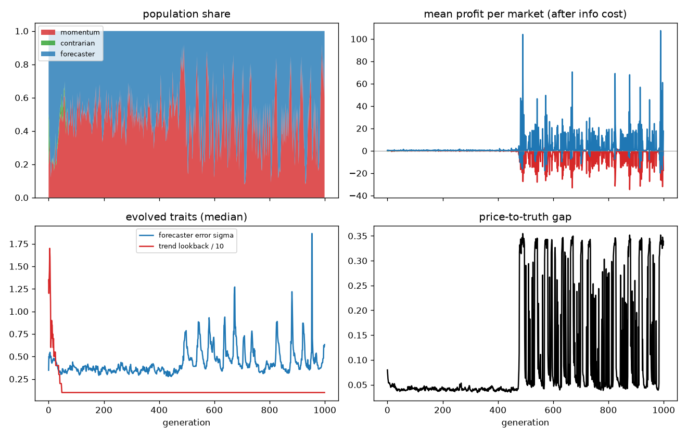
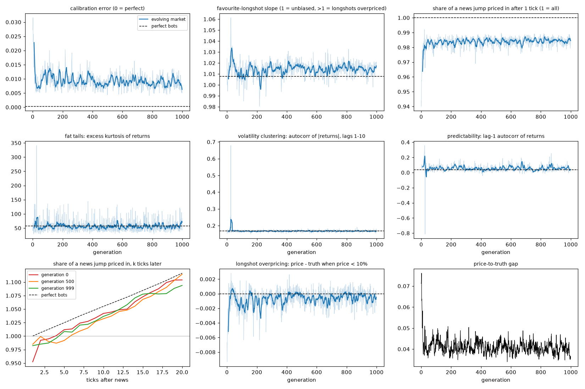

# Prediction Arena

A population of trading bots competing on simulated prediction markets. Bots trade, go bust and
reproduce; reinforcement-learning and Bayesian agents are dropped in to see whether they can keep
an edge against a population that evolves to exploit them.

## The market (`market.py`)

- **Truth.** Each market is a binary event. A hidden "score lead" does a random walk with rare news
  jumps, and the event happens if the lead is positive at the end. The true probability is the
  chance the lead holds given the time left: `p = Phi(lead / sqrt(var * ticks_left))`, so it drifts
  toward 0 or 1 as the market nears resolution.
- **Market maker.** An LMSR (logarithmic market scoring rule) market maker fills the net order of
  all bots each tick. Its worst-case loss per market is capped at `b * ln 2`.
- **Batch auction with limit orders.** Each tick, all orders clear at one price. Price-sensitive bots
  say how many shares they'd hold at any price, and the clearing price is solved (by bisection).
  Without this, bots reacting to the old price all piled in together and the price swung between
  ~0 and ~1 every tick.
- **Full collateral, as on real prediction markets.** A long position must be paid for in cash and a
  short must keep $1 per share in cash, fees included, so no bot can ever lose more than its budget.
  An early version without this let bots run up debt (one lost 240 on a budget of 100), and that fake
  money distorted the evolution results. A built-in check now has reckless bots trade at random at
  fees of 0, 1c and 5c and confirms nobody loses more than they had.
- **Speed.** One generation (400 markets x 200 ticks, 150 bots) takes ~3 s, all vectorised in numpy.

## Phase 1: does the market work?

50 random "punters" plus one test oracle that sees the true probability, over 100 markets. The
oracle is a deliberately unrealistic test instrument: if even a bot that knows the truth couldn't
pull the price to it, the market would be broken. It isn't used after Phase 1.

| | per market |
|---|---|
| Oracle profit | +26.0 |
| Punter profit | -0.2 each |
| Market maker P&L | -14.9 (worst -34.5, cap -34.7) |
| Price-to-truth gap | 0.115 with oracle vs 0.317 punters only |
| Calibration of the true probability | worst bin off by 1.7% (20k markets) |


## Phase 2: an evolving population (`evolve.py`)

- **Who trades:** 100 evolving strategy bots, plus 50 punters who don't evolve (they lose money, so
  evolution would wipe them out, and with them every other bot's profit).
- **Strategies (the genome):** trend followers hold `alpha x (log-odds move over the last L ticks)`
  (alpha > 0 momentum, < 0 contrarian); forecasters each have their own noisy estimate of the truth
  (error size sigma) and hold `alpha x (estimate - price)`. Half of every forecaster's error is shared
  with all the others in that market (same data, same models), so the crowd can't simply average its
  mistakes away. Accuracy costs `0.05 / sigma^2` per market, so forecasters choose how much to buy.
- **Each generation:** 400 fresh markets; fitness is total profit; the bottom 20 die and are replaced
  by mutated copies of tournament winners (best of 3); 5% of children switch strategy type; bot size
  is capped at 100. Results are from 3 seeds x 1000 generations.

Things that had to be fixed before the results meant anything (each mirrors a real market effect):

1. **Selection was half luck.** Over 100 markets, a bot's rank on one set of markets agreed with its
   rank on another at only 0.50; at 400 markets it's 0.91.
2. **Insiders starved everyone.** Two bots seeing 10 ticks ahead took most of the profit and killed
   the forecasters (adverse selection). They're out for now and return as a stress-test scenario.
3. **Too little "food".** The only free money is what punters lose; with small punters, the best
   strategy was to barely trade.
4. **Unbounded size made fake bubbles.** Bot size drifted from 13 to ~1000. Size is now capped.
5. **Independent errors made the market unrealistically perfect.** 50 forecasters with independent
   errors average them out almost completely; real traders' errors are correlated.
6. **Bots could lose money they didn't have** (no collateral; see above).

### Result: the same rules evolve into two different ecologies

**Seeds 0 and 2: a stable, accurate market.**


- Forecasters ~50%, contrarians ~44%, momentum ~6-7% (averages over generations 500-999).
- Contrarians have evolved to trade almost nothing (size ~1.3) and earn ~0; they survive because
  selection only removes the 20 worst bots, and a bot earning zero is never among them.
- Forecasters settle on an accuracy of sigma = 0.35 and are the only reliable earners (+0.3 per market).
- The price stays within 0.040 of the truth on average (perfect bots: 0.020), with no sustained
  bubbles (worst single generation: 0.14 in seed 2, 0.08 in seed 0).

**Seed 1: a momentum herd takes over and the market becomes unstable.**



- By generation 50, momentum bots are ~50% of the population (in the other seeds, contrarians took
  that niche). For ~475 generations they stay small (size ~10) and the market is calm.
- Between generations 450 and 500 their size runs away from 12 to the cap of 100, and from
  generation 477 the market flips between calm periods and bubbles where the price sits ~0.35 from
  the truth.
- Momentum bots lose money on average (-5.3 per market) while forecasters earn +5.6, yet the herd
  persists: the typical momentum bot profits, and its mutated copies with a different lookback trade
  out of step and absorb the losses. (Checked on a comparable evolved population, not yet on this
  exact run.)
- A bubble needs a momentum herd that is both numerous and large: in seeds 0 and 2 momentum bots are
  just as big (size ~40-50) but only 6-7% of the population, and the market never destabilises.

## Phase 3: measuring the market (`measure.py`)

Because the simulator knows the true probability, every measure compares the price with the truth
directly, and with a "perfect bots" benchmark on the same markets. Each measure is checked in
`python measure.py` on fake markets with a known answer (perfect, timid, slow).



Averages over generations 500-999:

| | perfect bots | seed 0 | seed 2 | seed 1 (herd) |
|---|---|---|---|---|
| price-to-truth gap | 0.020 | 0.041 | 0.040 | 0.146 |
| calibration error | 0.000 | 0.009 | 0.009 | 0.118 |
| share of news priced in after 1 tick | 1.00 | 0.98 | 0.98 | 0.78 |
| favourite-longshot slope (1 = unbiased) | 1.01 | 1.01 | 1.01 | 0.70 |
| predictability (lag-1 autocorr of returns) | 0.04 | 0.06 | 0.07 | 0.32 |

In the herd market, prices are too extreme (slope 0.70: longshots underpriced) and strongly
trending, which is exactly the footprint of a momentum crowd.

**What didn't emerge:** in the stable seeds, fat tails and volatility clustering match the
perfect-bot benchmark, so they come from the news jumps built into the truth, not from the bots.
There's no favourite-longshot bias either: punters here trade at random, while real punters overbet
longshots, and adding that preference is the obvious next experiment.

**Fees:** an earlier run suggested a 1c fee makes prices several times less accurate; it's being
re-run on the corrected market.

## Run it

```
python -m venv .venv
.venv/Scripts/pip install -r requirements.txt   # macOS/Linux: .venv/bin/pip
.venv/Scripts/python market.py      # Phase 1 checks + chart
.venv/Scripts/python measure.py     # Phase 3 measure checks
.venv/Scripts/python evolve.py      # Phase 2+3, 1000 generations (~50 min); --gens, --seed, --fee
```

## Roadmap

1. ~~Market core~~
2. ~~Evolving bot population~~
3. ~~Measurement~~
4. Learning agents: Kalman-filter Bayesian trader and PPO agent with the same private information as
   a forecaster, visible "on-chain" wallets, and the edge-decay experiment
5. Stress test: plug in your own bot and see how fast an adaptive population erodes its edge
6. Animated arena
